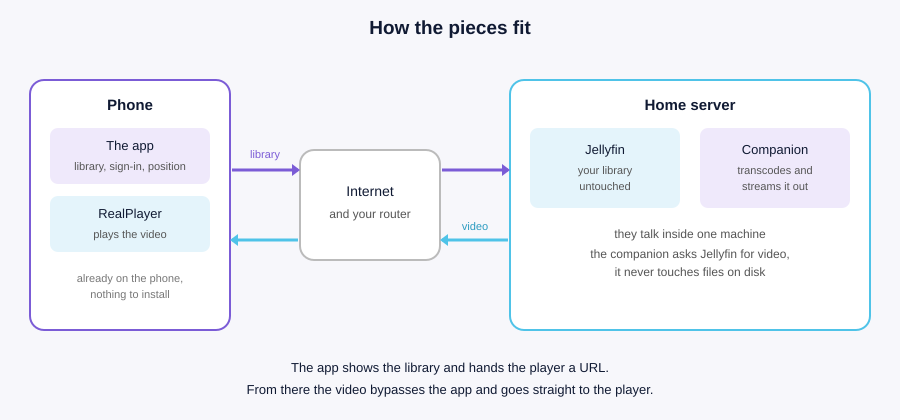

# Jellyfin for Symbian

**English** · [Русский](документация/README.md)

> Idea, requirements and all testing on real hardware — [@Hinduc0der](https://github.com/Hinduc0der).
> Code written by Claude (Anthropic) under his direction.

Your Jellyfin library on a phone from 2007: browse shows, resume where you left
off, watch video with sound — from anywhere you have a signal.

The phone needs nothing it doesn't already have. No third-party player, no
custom firmware, no space for downloads.

| | | |
|---|---|---|
|  |  |  |

## Two pieces

**The app on the phone** shows your library — collections, series, episodes,
continue-watching. Pick an episode and it hands the built-in player a URL. From
there the video goes straight to the player, bypassing the app entirely.

**The companion next to Jellyfin** transcodes on the fly to fit the phone's
screen and streams it over RTSP. It is not a plugin: to the companion, Jellyfin
is just a server it asks for video over the same HTTP API any client would use.
It never reads your media files from disk, so it needs no access to them.

Nothing sits between the two. No cloud, no relay, no account anywhere else.

## What you need

| | |
|---|---|
| Jellyfin | whatever you already run |
| a machine next to it | the same one Jellyfin runs on; Windows |
| a phone | Symbian S60 3rd edition or newer — most Nokia E- and N-series, 2007–2010 |
| a player on it | the built-in RealPlayer, already installed |
| network | at home, nothing; from outside, a public IP and two port forwards |

## What works, and what doesn't

**Works:** browsing the library, continue-watching, starting at any position,
sound, and playback progress reported back to Jellyfin while you watch — so
your other clients and the phone agree about where you are. Music plays as
a queue: press one track and the whole album follows, with auto-advance,
skipping and shuffle; the app plays it itself, and the companion is not
involved at all.

**Doesn't, and won't:** seeking *during* playback. The built-in player exposes
no scrub bar for streams and no fast-forward keys, and that is the player's
limitation, not the server's. You pick the position in the app before starting
instead — continue, start over, or type a minute. Also no subtitles and no
choosing between audio tracks.

**Quality:** sized to the phone's screen and no larger. On a typical device
that's 320x240, on a Nokia E90 it's 800x352 — roughly 200–600 kbit/s. An
episode costs less traffic than a single photo from a modern phone.

## This release

**Version 0.3.22.** The two packages are attached to the release:
`jellyfin-0.3.22-EN.sis` and `jellyfin-0.3.22-RU.sis`. They are one
application in two languages, so one installs over the other as an upgrade and
they cannot sit side by side. Installing a newer build over an older one keeps
your settings.

The app is signed with a self-made certificate, so the phone asks you to allow
installation from untrusted sources. Remove an older build before installing a
newer one if the phone refuses the upgrade.

What changed since the previous release is in [CHANGELOG.md](CHANGELOG.md).

## Getting started

1. [Server: install the companion next to Jellyfin](docs/01-server.md)
2. [Network: watching from outside your home](docs/02-network.md)
3. [Phone: install and first run](docs/03-phone.md)
4. [When it doesn't work](docs/04-troubleshooting.md)
5. [Notes for the Nokia E90](docs/05-nokia-e90.md)
6. [Building the app yourself](docs/06-building.md)

Start with the first one: until the companion is running, the phone has nothing
to talk to.

## Why this exists

Jellyfin's own clients need a modern phone. These devices can't run them, can't
decode what modern clients stream, and have maybe 128 MB of RAM. But they do
have an RTSP player built in, because that is how video worked in 2007 — and
RTSP is still RTSP.

So the work happens on the server, and the phone does only what it was always
able to do.

## License

GNU General Public License v3.0 — see [LICENSE](LICENSE).

Use it, change it, run it on anything you like. The one condition: if you
distribute a changed version, its source stays open under the same license.

### The icon

The application icon is the **Jellyfin logo**, taken from the project's own
[jellyfin-ux](https://github.com/jellyfin/jellyfin-ux) repository
(`branding/SVG/icon-transparent.svg`). Copyright belongs to the Jellyfin
contributors, and that repository is published under
[CC BY-SA 4.0](http://creativecommons.org/licenses/by-sa/4.0/).

**It has been modified.** The shapes are the original ones, unchanged; the
brand gradient was replaced by two solid colours taken from its own scale,
because Symbian icons are compiled from SVG Tiny 1.1, a format that has no
gradients at all.

Because the licence requires it, that modified icon —
[`klient/src/icon.svg`](klient/src/icon.svg) and the `.mif` built from it —
stays under **CC BY-SA 4.0**, not under this project's GPL-3.0. Anyone is free
to take it, change it further and pass it on, keeping the same licence and the
same credit.

The licence covers copyright, not names. The Jellyfin name and mark are used
here to say what this client talks to, and nothing more: this is an
independent client, not made by, endorsed by, or affiliated with the Jellyfin
project.
