# Phone: install and first run

**English** · [Русский](../документация/03-телефон.md)

## Install

There are two builds, identical apart from the language of their texts:
`jellyfin-EN.sis` and `jellyfin-RU.sis`. Pick one.

1. Copy it to the phone — Bluetooth, a memory card, or a cable, whichever is
   easiest.
2. Open it in File manager and install.
3. The phone will say the certificate is not trusted. Allow it anyway: the
   package is self-signed, because a Symbian developer certificate has not been
   issuable for many years.
4. It appears in the menu as **Jellyfin**, and under that name in the phone's
   list of installed programs.

Installing a newer version over an older one keeps your settings. Do not
uninstall first unless something is actually broken.

The two language builds share one identity, so they cannot sit side by side:
installing `jellyfin-EN.sis` over `jellyfin-RU.sis` replaces it and keeps your
settings. That is deliberate — two copies of the same app in the menu would
only confuse.

## First run

The app asks for the server address. Enter it as `host:port`:

```
192.168.1.50:8096
```

or, from outside, your public address or hostname with Jellyfin's port.

Then sign in. The app uses **Quick Connect**: it shows a six-digit code, and
you approve it from any browser already signed in to Jellyfin —
*Dashboard → Quick Connect*, or the prompt on your user page. No password is
typed on the phone's keypad, and none is stored on it.

After that you get the library.

## Using it

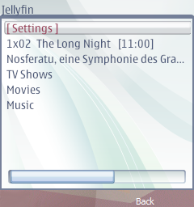
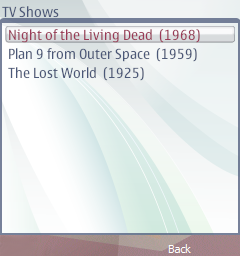
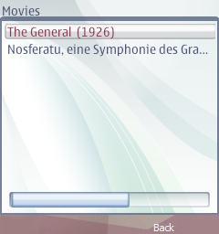
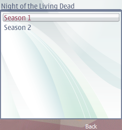
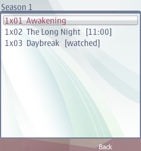


* **Up / down** — move through the list. **Select** — open.
* The first entry is **Settings**. It is first because the list below it is
  long, and because you need Settings precisely when nothing else is working.
* Continue-watching is at the top of the library, so the episode you were on is
  a couple of presses away.
* Pick an episode and the app asks where to start: continue from where you
  stopped, start over, or type a minute. "Continue" is preselected, so the
  usual case costs one more press. Then it hands the stream to RealPlayer,
  which opens on its own.

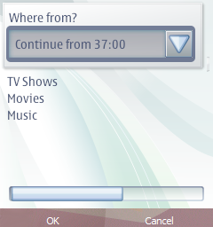
* Your position goes back to Jellyfin *while* you watch, not only when you
  stop. So your other clients agree with the phone about where you are, and
  nothing is lost if the phone's connection dies mid-episode.
* Close the player and the app asks the server where you stopped, then uses
  that. The position is set by the companion while the stream runs — the app
  never sees it happen, so without asking again it would offer you the minute
  you started from.

### Seeking during playback

**Hold** the scroll key up to fast-forward, down to rewind. A short press does
nothing, which is why the gesture is easy to miss: there is no scrub bar and no
hint on screen. It is RealPlayer's own control, documented in the Nokia user
guide, and it works on a stream as it does on a file. Left and right change the
volume.

For a long jump it is usually quicker to leave the player, pick the same
episode and choose "Start at a chosen minute..." — the app already knows where
you were, because the server reports your position as you watch.

### What the player will ask

RealPlayer may ask "connect to server?" every time it starts. That is its own
access-point prompt and the app cannot answer it: the app hands over a URL, and
how the player reaches the network is the player's business.

You can switch it off in the player: *Options → Settings → Streaming → Access
point*, and choose your network. It is worth doing — the question costs a few
seconds every single time.

### Music

Press a track and the **whole album** goes into the queue, starting from that
track, and the "Now playing" screen opens.

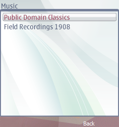
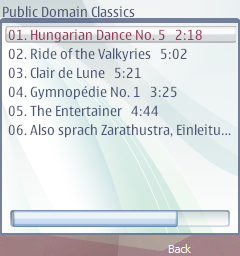

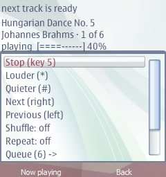

At the top is the player panel: title, artist, which track of how many, time
with a bar, and volume.

```
Shine On You Crazy Diamond
Pink Floyd · 3 of 9
1:23 [====------] 13:31
Volume [====------] 40%
```

| Row | What it does | Key |
|---|---|---|
| Stop / Play | stops; "Play" starts the track again | **5**, from any screen |
| Louder, Quieter | ten volume steps | `*` and `#` |
| Next track, Previous track | move through the queue | joystick right and left |
| Shuffle | reorders the queue; the track playing right now is not cut off | |
| Repeat | at the end the queue starts again | |
| Stop | close the player and forget the queue | |

The queue opens from its own row, "Queue (79) ->": it shows the whole list
with the current track marked `>`, and pressing a row jumps to it and returns
to the player. It is a separate screen so that the player's own commands fit
on screen without scrolling: with seventy-nine tracks, "Stop" was below the
fold.

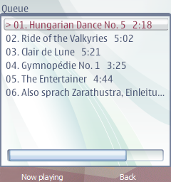

**Why "Stop" and not "Pause".** This phone has no pause and cannot have one:
the call that would do it hangs the device outright. Proved three times, on
different builds -- including one with everything else switched off, and an
older one from before the scrolling titles. So the row is honestly called
"Stop", and "Play" starts the track again. There is no way back to the spot
you left: seeking hangs the phone just the same.

"Close the player" is a different thing: it stops the sound, forgets the queue
and leaves the player screen.

**Long titles scroll.** The outer screen is 240 pixels wide, and neither a
long film title nor an episode file name fits. The row the selection is on
scrolls round until it has shown itself in full; the others stay put --
scrolling the whole list on a 332 MHz phone would mean the phone was busy
drawing instead of working.

**Leaving takes two presses.** Back at the top level no longer closes the
application straight away: the status line first says "Press Back once more to
leave Jellyfin", and that warning is good for three seconds. While music
plays it adds that the music will stop. People come back to the library by
pressing Back repeatedly without looking, and one press too many used to kill
the music along with the application.

**Getting back to the player** works from anywhere: while music plays the
**left soft key** says "Now playing", and the **`0`** key does the same. The
"Now playing" row at the top of the library is still there too.

**`*` and `#` change the volume on any screen** while music plays, not only in
the player. That is deliberate: the E90 has no side volume keys at all, and
when the music is too loud you should not have to walk through menus. The
chosen volume is remembered, and can also be set in advance in the settings.

Music is played by **the application itself**, not by the system player.
Otherwise there would be no auto-advance and no queue at all: there is no way
to hand a 2007 phone a playlist, and it cannot play from a link — it downloads
the whole file first. Hence what you see:

* the first track does not start instantly: it is downloaded in full, which
  takes 10–15 seconds on a home network;
* the next one is fetched in advance while the current one plays, so there is
  no gap between tracks;
* you can browse the library while music plays: the player stays alive and
  "Now playing" appears as the first row of the root list;
* music comes straight from Jellyfin and needs no companion — it works even
  when the companion is not running;
* downloads live **on the memory card**, in `E:\Data\Jellyfin\music`, and are
  trimmed automatically once they pass 60 MB. With no card music goes to phone
  memory (`C:\Data\Jellyfin\music`) and the limit is only 7 MB: the current
  track and the next one, everything else is wiped at once. The E90 has a few
  dozen megabytes of internal memory for everything, and filling it with music
  would leave nothing for the phone itself.

How much is used, and how to clear it: the "Clear music cache" row in the
settings. The track playing now and the next one survive, so the music does
not break off; settings and sign-in survive too.

If the memory card disappears mid-session, music moves to phone memory by
itself -- the log says "could not write to the card: music moves to phone
memory".

**There is no seeking inside a track, and there will not be.** The only call
Phonon offers for it, `seek`, freezes this phone outright. It is gone from the
app entirely, including as a fallback after a pause -- so if resuming does not
take on the first try, the track starts from the beginning.

**The queue survives leaving.** The phone does not keep music in the
background: close the application and the music stops, otherwise there would
be no queue at all. The queue itself is not lost, though: at the next start
the first row of the root list is "Carry on listening: <track>". It does not
play by itself -- starting sound and reaching for the network uninvited at
every launch is not wanted. Pressing "Stop" forgets the queue deliberately.

**The queue is longer than one page.** Items arrive from the server fifty at a
time, so a folder of a thousand tracks would otherwise loop round the first
fifty. As the end of what is loaded comes near, the application asks for the
next page itself and adds it to the queue, up to 400 tracks (more than that has
nowhere to live in phone memory).

Shuffle changes the request as well: the random tracks are picked by the
**server, across the whole folder**, not by us out of the fifty on screen. For
a big folder with no albums that is the only way to get real randomness.

**Video takes the sound, and that is normal.** The phone has one audio device:
the system player takes it as soon as it starts. So before handing over a
video the application pauses the music itself -- and carries on from the same
spot once the player closes.

The album cover is shown to the left of the panel when the server has one.
Jellyfin shrinks it itself, to 96 pixels -- 5-10 KB -- and it lives in the
music folder, one per album.

### Settings

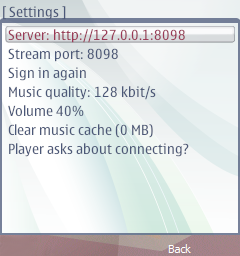


* **Server** — the address. Changing it also changes where video comes from.
* **Stream port** — 554 by default; set it to whatever the router forwards
  from outside (see [the network chapter](02-network.md)).
* **Sign in again** — forgets the token and starts Quick Connect over.
* **Music quality** — how many kbit/s to ask Jellyfin for: lower starts
  sooner, higher sounds cleaner on headphones.
* **Volume** — steps 0..10 for later sessions; while music plays use `*` and `#`.
* **Clear music cache** — shows how much the downloaded tracks take and removes
  them.
* **Version** — which build is installed. The same number is in the first
  line of the log, so a log you send says what produced it.
* **Player asks about connecting?** — not a setting but an explanation of that
  prompt, and where in the player to switch it off.

Settings is the first row of the library on purpose: it is what you need
exactly when nothing else is working.

Everything the app did is written to `C:\Data\Jellyfin\jellyfin.log` on the
phone. If you report a problem, that file is the useful attachment.

## Black bars around the picture

Most content is 16:9 and almost no phone screen is. The companion fits the
whole frame inside the screen and pads what is left, rather than cropping to
fill — so you see the whole picture with bars, instead of a full screen with
the edges cut off.

On a 4:3 screen (320x240) that means bars above and below. On the E90's very
wide screen it is the other way round — see [the E90 page](05-nokia-e90.md).

If you would rather fill the screen and lose the edges, set `PROBA_ZAPOLNIT=1`
on the server. It is a server-wide setting, not a per-phone one.

## How much data it uses

Roughly 200 kbit/s at 320x240 and 600 kbit/s at 800x352 — video and audio
together. That is about **90 MB per hour** on a typical screen, or 270 MB per
hour on an E90.

For comparison, a single photo from a current phone is several megabytes. An
episode costs about as much as a short browsing session.
