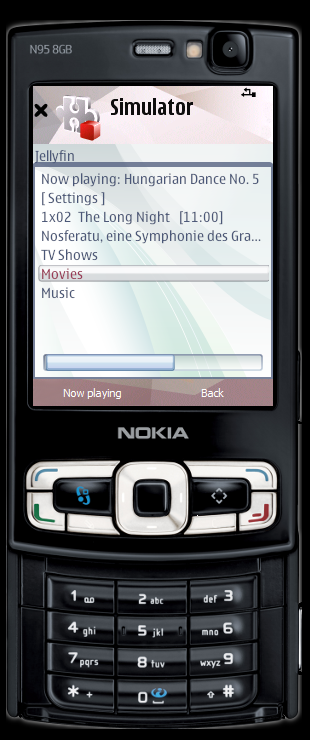

# Building it yourself

**English** · русской версии нет

You do not need this to use the project: both builds are attached to the
release. This page is for changing the app — adding a language, fixing
something, or just checking that the binary matches the source.

The companion needs no build at all. It is plain Python with no dependencies:
copy `kompanion/` and run it. Everything below is about the phone app.

## What you need

| | |
|---|---|
| OS | Windows |
| SDK | Qt SDK 1.1 (the old Nokia one), **Symbian^1 / Qt 4.7.3** target |
| compiler | GCCE 4.4, which ships inside that SDK |

The scripts expect the SDK where its installer puts it:

```
C:\QtSDK\Symbian\SDKs\Symbian1Qt473     the SDK itself
C:\QtSDK\Symbian\tools\gcce4            the compiler
```

If yours lives elsewhere, change `SDKPREFIX` and `SYMBIANDIR` at the top of
`klient/build-symbian.bat`.

This toolchain was discontinued around 2012 and is no longer distributed by
anyone official. There is no newer one: Symbian support was removed from Qt
after 4.8, so Qt 4.7.3 is not a preference, it is the only option.

## Build

From `klient/`:

```
build-symbian.bat            ->  jellyfin-RU.sis   (Russian)
build-symbian.bat en         ->  jellyfin-EN.sis   (English)
СОБРАТЬ-ОБЕ.bat              ->  both, one after the other
build-symbian.bat clean      ->  wipe the work tree
```

Each build also leaves a copy named with the version, like
`jellyfin-0.3.22-EN.sis`. The short name is what goes to a release; the
versioned one is for keeping track of what is installed where.

### Why it copies the sources somewhere else first

The script mirrors `klient/` to `C:\jvbuild\klient` and builds there. The 2011
toolchain mishandles non-Latin characters in paths, and this repository lives
in a directory with Cyrillic in its name. Mirroring is cheaper than fighting
it. Set `DP_WORK` to put the work tree somewhere else.

### Why the work tree gets wiped between languages

The texts are compiled in, so object files from a Russian build are wrong for
an English one. Mixing them produces link errors rather than an honest failure,
so the script wipes the tree whenever the build options differ from last time.
That is also why building both takes twice as long as building one.

## How the two languages work

Every string the user sees lives in `klient/src/slova.h`, twice: once under
`#ifdef JF_EN`, once under `#else`. The English build is just
`qmake DEFINES+=JF_EN`.

No `.qm` files, no language setting in the app. On a phone like this the
language is chosen once and never revisited, and every extra file in the
package is another way for installation to fail.

To add a third language, add a branch to `slova.h` and pass your own define.
The messages written to the phone's log file are the same strings, on purpose:
when someone sends you a log, it should be readable by the person sending it.

## The two builds are one app

`TARGET`, `TARGET.UID3` and `VERSION` are identical in both. Symbian
identifies an application by its UID3, so:

* installing one over the other is an **upgrade**, and settings survive;
* they **cannot** be installed side by side.

This is deliberate. Keep it that way unless you really want two separate
applications, in which case you need a different UID3 as well as a different
`TARGET` — and then upgrades between them stop working.

## `TARGET` and what users actually see

`TARGET` is `JfE90`, after the first version of this app, and the name looks
wrong for a project called Jellyfin. It does not matter, because **the
executable name is never shown to anyone**:

* the installed-applications list shows the *package* name, from the
  `#{"..."}` header in `klient.pro`;
* the menu caption comes from `DEPLOYMENT.display_name`.

So the file can be `JfE90` while the package is "Jellyfin for S60" and the
menu says "Jellyfin".

Renaming it is therefore safe but pointless, and it has a small cost:
`TARGET` decides the names of all four installed files, so an upgrade over a
package that used the previous name leaves the old files behind on the phone.

If you fork this and want your own identity, change `TARGET.UID3` *and*
`TARGET` together, on a device with no previous version installed.

## Check that the package contains the code you think it does

This costs seconds. Do it whenever a build behaves unexpectedly on the
device:

```
dumpsis -x jellyfin-RU.sis               # file0 is the executable
elftran -dump i file0                    # imported DLLs and ordinals
elftran -compressionmethod none file0    # strips bytepair, in place
```

Symbian images are bytepair-compressed, so searching a `.sis` for strings
finds nothing until that third command has run. Afterwards the image's own
string literals are plain ASCII in the file, which is enough to tell whether
the build really came from the current sources.

Two habits go with it: **never edit sources while a build is running** (the
build mirrors them to `C:\jvbuild` at the start, so a later edit silently
does not reach the package), and resolve an ordinal to a name with

```
arm-none-symbianelf-nm -D QtCore.dso     # ordinal = value / 4 + 1
```

A name like `_._.absent_export_1378` means that symbol is missing on the
device: the app will link and then fail to start with no message at all.

## Startup markers, when the app will not launch

An app that dies during startup leaves no log, because the log lives in a
folder the app creates while starting. Build with the markers switched on:

```
build-symbian.bat ru metki
```

Every step of startup then drops an empty file in `C:\Data`
(`jf-00-do-app.txt`, `jf-01-app.txt`, ...), and the last one that appears
says where it stopped. The markers write through `QFile`, whose `open`,
`write` and `close` the image already imports, so they add no dependency of
their own and cannot themselves be the reason it will not start.

Reach for them early. A call that is inlined -- a method on an object that is
not constructed yet, say -- leaves no trace in the image's imports, so
comparing imports, capabilities, headers and resources against a working build
will show nothing at all.

## A desktop test bench

The same sources build against the SDK's desktop Qt 4.7.3, which is the exact
Qt the device build uses. That is the quickest way to see a change, and it is
where the screenshots in this documentation come from.

```
robocopy klient C:\jkwin\klient-en /MIR /XD .git debug release
cd C:\jkwin\klient-en
set PATH=C:\QtSDK\Simulator\Qt\mingwin;C:\QtSDK\mingwin;%PATH%
qmake -spec win32-g++ DEFINES+=JF_EN
mingw32-make release
```

The SDK's desktop Qt draws the app inside the Qt Simulator. In the simulator's
*View* panel pick the device **Symbian NonTouch** and drag *Zoom* to the right:
the screen then is a real 240x320, the same size as the E90's outer display,
inside a phone skin.



What the bench does not give you: sound (the device's media stack is where the
surprises are), the soft keys, the keypad, and the real speed. The last word
still belongs to the phone.

A full Symbian emulator (EKA2L1 with an N95 ROM) gets an app as far as the
screen and then kills it: that happens to every Qt app, this one and others
alike, so it is the emulator's Qt support, not the app. Native ROM apps run
in it fine.

## Versions

`VERSION` in `klient/klient.pro` is the one place. Bump it before any build you
install on a phone or hand to anybody: the version ends up in the file name,
packages are installed by hand and they pile up, and without it you cannot tell
later what is actually running on the phone.

## Signing

The package is self-signed, and the build says so:

```
Package is compatible with self-signing.
```

That works because the app asks only for capabilities Symbian lets anyone
self-sign: `NetworkServices`, `ReadUserData`, `WriteUserData`,
`UserEnvironment`. The phone will warn that the supplier cannot be verified.
That warning is unavoidable — Symbian developer certificates stopped being
issued years ago — and it is why the install instructions tell people to accept
it.

If you add a capability outside the self-signable set, the build will still
produce a `.sis` and the phone will refuse to install it.

## If the build fails

The full compiler output goes to `C:\jvbuild\build.log` (or `%DP_WORK%`). The
script greps it for errors rather than trusting the exit code, because `abld`
is a Perl script that returns 0 even when the build has failed.

Two failures worth knowing:

* **`undefined reference` to something in your own code** — stale object files.
  Run `build-symbian.bat clean` and build again.
* **the app installs but will not start, "function not supported"** — you
  introduced a 32-bit integer division. The E90's runtime has no
  `__aeabi_idiv`, so `a / b` on `int` links fine and dies on launch. Divide
  64-bit values instead (`qint64`, `Q_INT64_C`), as `asClock()` does, or
  multiply by a reciprocal.
