# Телефон: установка и первый запуск

[English](../docs/03-phone.md) · **Русский**

Нужен телефон на Symbian S60 3rd edition или новее — это почти все кнопочные
Nokia 2007–2010 годов: E51, E61, E71, E90, N73, N95 и их соседи.

## Установка

1. Перепишите файл `jellyfin-<версия>-RU.sis` на телефон — по кабелю, по Bluetooth
   или на карту памяти.

2. Прежде чем ставить, разрешите установку неподписанных программ:
   **Меню → Средства → Диспетчер прил. → Параметры → Настройки**

   | Настройка | Значение |
   |---|---|
   | Установка программ | Все |
   | Проверка сертификата в сети | Выкл. |

   Программа подписана «сама собой»: у неё нет денег на подпись Symbian, зато
   и прав она просит ровно четыре — сеть, чтение и запись своих настроек, да
   запуск плеера.

3. Откройте файл на телефоне и согласитесь с установкой.

В меню появится **Jellyfin**.

## Первый запуск

Приложение спросит одну вещь — адрес вашего Jellyfin:

```
192.168.1.50:8096
```

Больше ничего набирать не придётся: дальше вход идёт **по коду**.

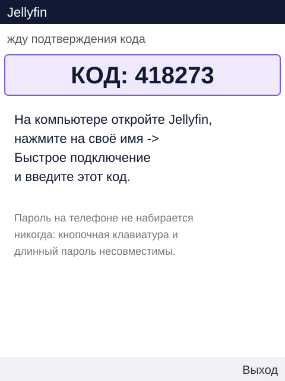

На телефоне появится шестизначный код. Откройте Jellyfin на компьютере,
нажмите на своё имя → **Быстрое подключение**, введите код — и приложение
войдёт само.

Пароль на телефоне не набирается никогда. Кнопочная клавиатура и длинный
пароль со знаками — это десять минут мучений и три опечатки.

## Как этим пользоваться

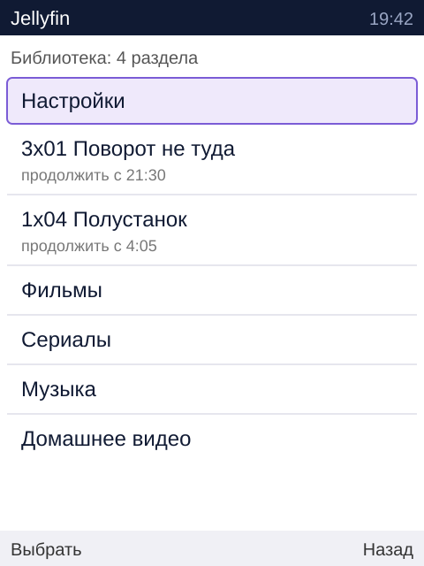

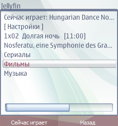
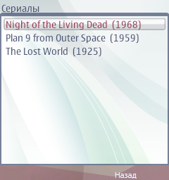
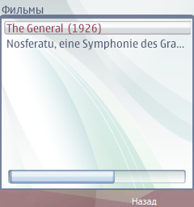
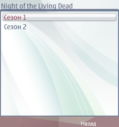
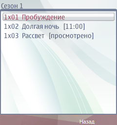

В корне списка: сначала **Настройки**, затем недосмотренное («продолжить
с 21:30»), затем разделы библиотеки.

Недосмотренное стоит наверху нарочно: чаще всего телефон берут в руки именно
затем, чтобы досмотреть начатое, а не бродить по дереву.

Закрыли плеер — приложение спрашивает у сервера, где вы остановились, и
дальше пользуется этим. Место отмечает компаньон, пока идёт поток, и само
приложение этого не видит: не спроси оно заново — предлагало бы ту минуту, с
которой вы начали.

Выбираете серию — приложение спрашивает, с какого места играть, и отдаёт
плееру адрес. Дальше показывает уже RealPlayer.

### Что спросит плеер

При первом запуске RealPlayer может спросить **«Требуется подключение к
серверу?»** — это значит, что у него самого не выбрана точка доступа. Вопрос
стоит четырёх секунд ожидания, и его легко убрать насовсем:

**RealPlayer → Функции → Параметры → Настройки → Поток → Точка доступа** →
выберите свою сеть.

Из приложения на это повлиять нельзя: мы отдаём плееру адрес, а чем ему идти
в сеть — решает он.

### Музыка

Нажимаете песню — в очередь встаёт **весь альбом**, начиная с неё, и
открывается экран «Сейчас играет».

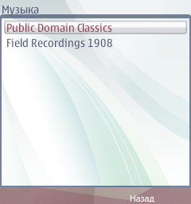
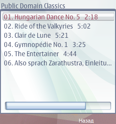

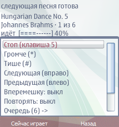

Сверху — табло плеера: название, исполнитель, какая песня по счёту, время с
полоской и громкость.

```
Shine On You Crazy Diamond
Pink Floyd · 3 из 9
1:23 [====------] 13:31
Громкость [====------] 40%
```

| Строка | Что делает | Клавиша |
|---|---|---|
| Стоп / Играть | останавливает; «Играть» начинает песню заново | **5**, с любого экрана |
| Громче, Тише | десять ступеней громкости | `*` и `#` |
| Следующая, Предыдущая | переход по очереди | джойстик вправо и влево |
| Вперемешку | меняет порядок очереди; та песня, что звучит сейчас, не обрывается | |
| Повторять | дойдя до конца, очередь начинается сначала | |
| Остановить | закрыть плеер и забыть очередь | |

Очередь открывается отдельной строкой «Очередь (79) →»: там видно весь
список, идущая песня помечена `>`, нажатие переходит к ней и возвращает в
плеер. Отдельным экраном — чтобы сами команды плеера влезали в экран целиком,
без прокрутки: при семидесяти девяти песнях до «Остановить» приходилось
листать.

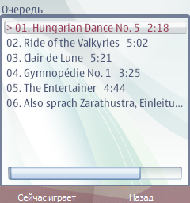

**Почему «Стоп», а не «Пауза».** Паузы на этом телефоне нет и быть не может:
вызов, который её делает, вешает аппарат наглухо. Проверено трижды — на
разных сборках, в том числе на той, где всё остальное было отключено, и на
старой, до бегущей строки. Поэтому кнопка честно называется «Стоп», а
«Играть» начинает песню заново. Вернуться на то место, где остановились,
нечем: перемотка вешает телефон точно так же.

Строка «Закрыть плеер» — это другое: она не только останавливает звук, но и
забывает очередь и уводит с экрана плеера.

**Длинные названия едут бегущей строкой.** Экран снаружи 240 точек, и в него
не влезает ни «Люди Икс: Последняя битва», ни имя серии из раздачи. Та строка,
на которой стоит выбор, едет по кругу, пока не покажет себя целиком;
остальные стоят на месте — гонять весь список на 332 МГц значило бы занять
телефон рисованием вместо дела.

**Выход — с двух нажатий.** «Назад» на верхнем уровне больше не закрывает
приложение сразу: сначала в строке состояния появляется «Ещё раз «Назад» — и
выход из Jellyfin», и у этого предупреждения три секунды силы. Когда играет
музыка, там же сказано, что она остановится. К библиотеке возвращаются, нажимая
«Назад» подряд и не глядя на экран, и одно лишнее нажатие глушило музыку
вместе с приложением.

**Вернуться к плееру** можно откуда угодно: пока музыка идёт, на **левой
софт-клавише** стоит «Сейчас играет», и то же делает клавиша **`0`**. Строка
«Сейчас играет» в корне библиотеки тоже осталась.

**Громкость `*` и `#` работает на любом экране**, пока играет музыка, — не
только в плеере. Так сделано нарочно: боковых клавиш громкости у E90 нет
вовсе, и когда музыка бьёт по ушам, искать регулятор по меню незачем.
Выбранная громкость запоминается; её же можно задать заранее в настройках.

Музыку играет **само приложение**, а не системный плеер. Иначе не было бы ни
автоперехода, ни очереди вовсе: передать телефону 2007 года список
воспроизведения нечем, а по ссылке он играть не умеет — сначала качает файл
целиком. Отсюда то, что видно глазами:

* первая песня начинает звучать не мгновенно: она целиком приезжает в
  телефон, на домашней сети это 10–15 секунд;
* следующая качается заранее, пока играет текущая, — между песнями паузы
  уже нет;
* пока играет музыка, по библиотеке можно ходить: плеер не закрывается, а
  первой строкой в корне появляется «Сейчас играет»;
* музыка идёт прямо из Jellyfin и компаньона не требует — работает, даже
  когда тот не запущен;
* скачанное лежит **на карте памяти**, в `E:\Data\Jellyfin\music`, и
  подрезается само, когда перевалит за 60 МБ. Карты нет — музыка пишется в
  память телефона (`C:\Data\Jellyfin\music`), и тогда предел всего 7 МБ:
  текущая песня и следующая, остальное затирается сразу. Во внутренней памяти
  E90 свободно несколько десятков мегабайт на всё, и занимать её музыкой
  нельзя — телефону тогда не останется ничего.

Сколько занято и как это убрать — строка «Очистить кэш музыки» в настройках.
Играющая песня и следующая при очистке остаются, музыка не прерывается;
настройки и вход тоже на месте.

Если карта памяти пропадёт на ходу, музыка переедет в память телефона сама —
в журнале это строка «на карту не пишется: музыка уходит в память телефона».

**Перемотки внутри песни нет, и не будет.** Единственный способ перемотки у
Phonon — вызов `seek`, и на этом телефоне он вешает аппарат наглухо. Он убран
целиком, в том числе как запасной путь после паузы — поэтому, если продолжение
после паузы не сработает с первого раза, песня начнётся с начала.

**Очередь переживает выход.** Телефон не держит музыку фоном: закрыли
приложение — музыка смолкла, иначе очереди не бывает вовсе. Зато собранная
очередь не теряется: при следующем запуске первой строкой в корне стоит
«Продолжить слушать: <песня>». Сама она не играет — начинать звук и лезть в
сеть без спроса при каждом запуске незачем. Нажали «Остановить» — очередь
забывается нарочно.

**Очередь длиннее страницы.** С сервера записи приезжают по 50, и в папке на
тысячу песен очередь иначе крутилась бы между первой и пятидесятой. Подходя к
концу загруженного, приложение само просит следующую страницу и дописывает её
в очередь, пока не наберётся 400 песен (больше в памяти телефона держать
нечего).

Включённое «вперемешку» при этом меняет и сам запрос: случайные песни выбирает
**сервер, по всей папке**, а не мы по видимым пятидесяти. Для большой папки без
альбомов это единственный способ получить настоящую случайность.

**Видео отбирает звук, и это нормально.** Звуковое устройство у телефона
одно: системный плеер, запустившись, забирает его себе. Поэтому перед
запуском видео приложение само ставит музыку на паузу — и, когда плеер
закроется, само же её продолжает с того места.

Обложка альбома показывается слева от табло, если она на сервере есть.
Jellyfin уменьшает её сам, до 96 точек — это 5–10 КБ, и лежит она в той же
папке с музыкой, одна на альбом.

### Настройки

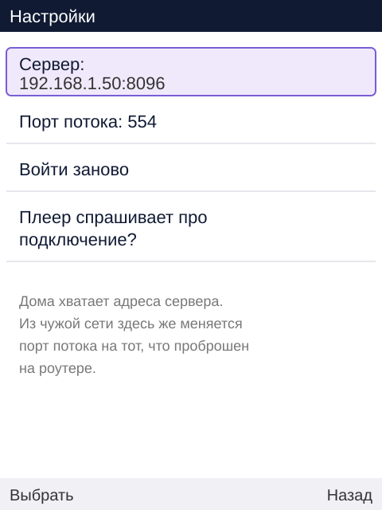

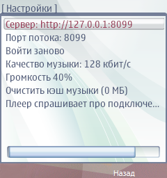

| Пункт | Когда нужен |
|---|---|
| Сервер | переехали, сменился адрес, или смотрите из другой сети |
| Версия | какая сборка стоит; то же число — первой строкой журнала, так что присланный журнал говорит, чем он снят |
| Порт потока | только если смотрите снаружи и проброшен нестандартный порт (см. [главу про сеть](02-сеть.md)) |
| Войти заново | сменился пользователь или пропал доступ |
| Качество музыки | сколько кбит/с просить у Jellyfin: меньше — быстрее начинается, больше — чище в наушниках |
| Громкость | ступени 0..10 на будущие запуски; на ходу её меняют `*` и `#` |
| Очистить кэш музыки | показывает, сколько занято скачанными песнями, и убирает их |
| Плеер спрашивает про подключение? | подсказка, где это выключить |

Настройки стоят первым пунктом нарочно: нужны они обычно тогда, когда ничего
не работает, и искать их в конце длинного списка — последнее, чего хочется в
этот момент.

## Чёрные поля вокруг картинки

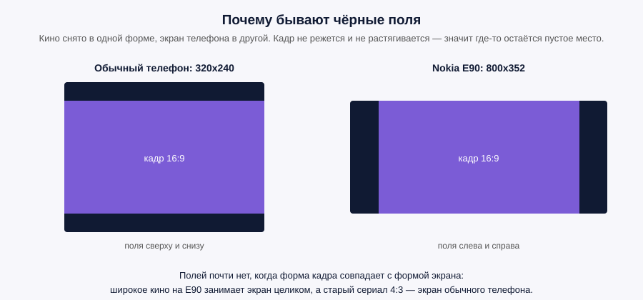

Кадр не режется и не растягивается — значит где-то остаётся пустое место.
Современное кино шире, чем экран обычного телефона, поэтому сверху и снизу
будут чёрные полосы. На широком экране Nokia E90 наоборот: полосы по бокам, а
широкое кино ложится почти без них.

Если полосы мешают сильнее, чем потеря части кадра, на сервере есть настройка
`PROBA_ZAPOLNIT=1` — тогда картинка увеличивается до краёв экрана, а лишнее
срезается. Пропорции при этом не меняются: вытянутых лиц не будет.

## Сколько это ест трафика

Картинка делается ровно под экран и не больше: на обычном телефоне это
200–300 кбит/с вместе со звуком. Серия на 45 минут — около 100 МБ, то есть как
десяток фотографий с современного телефона.

Специально экономить не нужно, но смотреть сутки напролёт с пакетом в 5 ГБ не
стоит.
