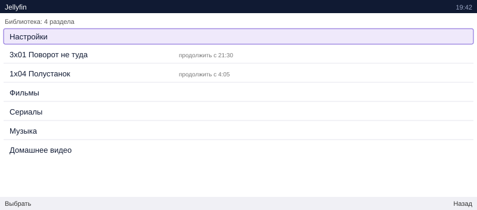

# Отдельно про Nokia E90

[English](../docs/05-nokia-e90.md) · **Русский**

E90 — особенный случай. Внутри у него экран 800x352: шире, чем у любого
телефона тех лет, и шире, чем у многих нынешних. Поэтому для него всё
настраивается иначе, чем для обычного S60.

## Два экрана

У E90 их два: 240x320 снаружи, под крышкой — 800x352. Приложение смотрит, на
каком работает, и просит картинку под него. Если открыть крышку во время
работы, оно запомнит больший — чтобы не получилось так, что видео заказано под
маленький экран, а смотреть его собираются на большом.

Настраивать это не нужно.

## Картинка

| | обычный S60 | E90 |
|---|---|---|
| картинка | 320x240 | 800x352 |
| поток | около 200 кбит/с | около 600 кбит/с |
| форма экрана | 4:3 | 2.27:1, шире чем у кино |

На сервере это задаётся `PROBA_EKRAN=800x352`, но только как значение по
умолчанию: приложение всё равно называет свой экран само.

## Поля вокруг кадра — наоборот

На обычном телефоне чёрные полосы остаются сверху и снизу. На E90 — слева и
справа: его экран шире, чем 16:9, в котором снято почти всё.

Зато широкое кино (2.39:1) ложится на этот экран почти точно, без полей вовсе.
Такого не даёт ни один современный телефон.

## Чего от E90 не ждать

Процессор у него 332 МГц, и декодирует он видео сам. 800x352 при 24 кадрах он
тянет, но без запаса: поток плотнее 700 кбит/с смысла не имеет — лишние
килобиты не станут чёткостью, а на мобильном канале только добавят потерь.

## Отчего «подключение невозможно» именно на E90

Если RealPlayer ругается сразу, не дойдя до сервера, причина почти всегда в
одном из двух:

1. **Точка доступа не выбрана.** RealPlayer спрашивает про подключение и, не
   дождавшись, бросает. Лечится: Функции → Параметры → Настройки → Поток →
   Точка доступа.
2. **Порт 554 на роутере.** Классическая беда домашних роутеров со встроенным
   «помощником RTSP»: правило есть, а порт снаружи мёртв. Берите 8554 и
   укажите его в настройках приложения. Подробно — в
   [главе про сеть](02-сеть.md).
