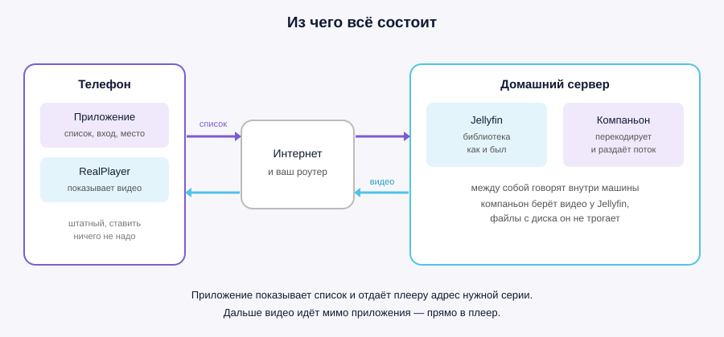

# Jellyfin на кнопочном смартфоне

[English](../README.md) · **Русский**

> Замысел, постановка задачи и проверка на живом железе — [@Hinduc0der](https://github.com/Hinduc0der).
> Код написан Claude (Anthropic) под его руководством.

Домашняя библиотека Jellyfin на телефоне 2007 года: список серий, «продолжить
просмотр», видео со звуком. Из любой точки, где ловит сеть.

Телефону при этом не нужно ничего, кроме того, что в нём уже есть. Ни плеера
со стороны, ни прошивки, ни памяти на закачку.

| | | |
|---|---|---|
|  |  |  |

## Из двух частей

**Приложение на телефоне** показывает библиотеку: разделы, сериалы, серии,
недосмотренное. Когда выбираешь серию, оно отдаёт штатному плееру адрес — и
дальше видео идёт мимо приложения, прямо в плеер.

**Компаньон рядом с Jellyfin** перекодирует видео на лету под экран телефона и
раздаёт его потоком. Он не плагин: Jellyfin для него — обычный сервер, у
которого он спрашивает видео по тому же адресу, по какому спросил бы любой
клиент. Файлы библиотеки на диске он не трогает вовсе.

Между ними ничего нет. Ни облака, ни чужого сервера, ни учётной записи
где-то ещё.

## Что для этого нужно

| | |
|---|---|
| Jellyfin | любой, который у вас уже работает |
| машина рядом с ним | та же, на которой стоит Jellyfin; Windows |
| телефон | Symbian S60 3rd edition и новее — Nokia E-, N- и большинство кнопочных Nokia 2007–2010 годов |
| плеер на телефоне | штатный RealPlayer, он уже стоит |
| сеть | дома — ничего; из чужой сети — белый адрес и два проброса на роутере |

## Чего ждать и чего не ждать

**Работает:** список библиотеки, поиск по разделам, «продолжить просмотр» с
того же места, перемотка на начало выбранной секунды, звук, отметка просмотра
обратно в Jellyfin. Музыка играет очередью: нажал песню — идёт весь
альбом, с переходом к следующей, переключением и вперемешку;
её играет само приложение, и компаньон для неё не нужен вовсе.

**Перемотка на ходу:** удерживайте джойстик **вверх** — вперёд, **вниз** —
назад. Шкалы у плеера нет, удержание и есть весь интерфейс; это собственное
управление RealPlayer, описанное в руководстве к телефону. Влево-вправо меняют
громкость. Для большого прыжка по-прежнему быстрее выйти и запустить серию с
выбранной минуты.

**Не работает и не будет:** субтитры, несколько звуковых дорожек на выбор.

**Качество:** картинка под экран телефона и не больше. На обычном экране это
320x240, на Nokia E90 — 800x352. Это примерно 200–600 кбит/с, то есть серия
весит меньше, чем одна фотография с современного телефона.

## Эта версия

**0.3.22.** К выпуску приложены два пакета: `jellyfin-0.3.22-RU.sis` и
`jellyfin-0.3.22-EN.sis`. Это одно приложение на двух языках: одно ставится
поверх другого как обновление, рядом они не встанут. Установка новой сборки
поверх старой настройки не теряет.

Подпись самодельная, поэтому телефон попросит разрешить установку из
недоверенных источников. Если он отказывается обновляться — снесите старую
сборку и поставьте заново.

Что изменилось с прошлого выпуска — в [ИЗМЕНЕНИЯ.md](ИЗМЕНЕНИЯ.md).

## Инструкции

1. [Сервер: ставим компаньона рядом с Jellyfin](01-сервер.md)
2. [Сеть: как смотреть из любой точки](02-сеть.md)
3. [Телефон: установка и первый запуск](03-телефон.md)
4. [Если не работает](04-если-не-работает.md)
5. [Отдельно про Nokia E90](05-E90.md)

Начинать с первой: пока нет компаньона, телефону не с кем разговаривать.
